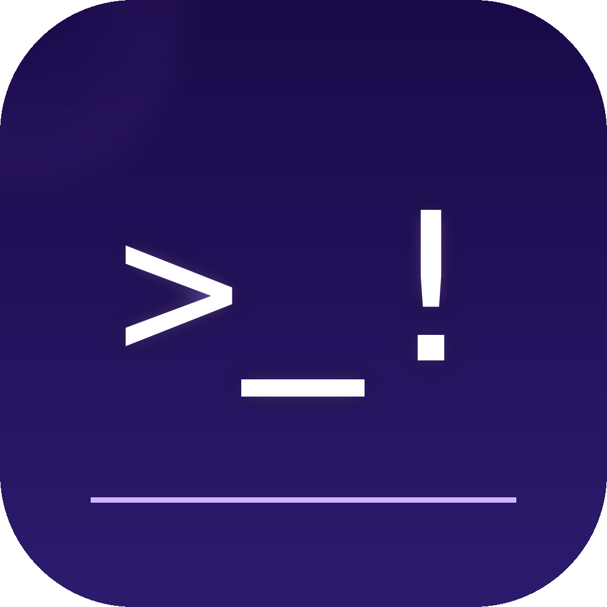

<div align="center">
  
  <h1>ShellGuard for Mac</h1>
  <p><strong>macOS menu bar app for <a href="https://github.com/s4e-io/shellguard">ShellGuard</a></strong></p>

  []()
  []()
  [](LICENSE)
</div>

> **⚠️ Beta — Internal Use**
> This app is under active development and not yet production-ready. Hook integration with Gemini CLI (Antigravity) and Claude CLI may be incomplete or unreliable on all configurations. Currently developed for internal use at [s4e.io](https://s4e.io) — use at your own risk.

---

Native macOS menu bar app that wraps the [ShellGuard CLI](https://github.com/s4e-io/shellguard). It installs the binary, manages hook configurations for each AI tool, and shows a live activity log — all from the menu bar.

**The security logic lives in the CLI.** This app is a GUI layer on top.

---

## Features

- **One-click hook setup** — enable ShellGuard for Claude Code, Cursor, Codex, Gemini CLI, VS Code with a single toggle
- **Mode switching** — switch between `log only`, `dev`, `read only`, `custom` from the menu bar
- **Live log viewer** — see every command your AI tools run in real time
- **Policy editor** — edit `policy.yaml` blocked/allowed lists from the UI
- **Onboarding** — guided first-run setup

---

## Requirements

- macOS 14.0+
- [ShellGuard CLI](https://github.com/s4e-io/shellguard) installed at `/usr/local/bin/shellguard`

---

## Installation

### Mac App Store
[Download on the Mac App Store](https://apps.apple.com/app/shell-guard/) *(coming soon)*

### DMG (direct)
Download `ShellGuard.dmg` from [Releases](../../releases), open it, drag **ShellGuard.app** to `/Applications`.

The app is notarized by Apple — no Gatekeeper warning.

---

## Building from Source

Requires Xcode Command Line Tools and a Go installation.

```bash
git clone https://github.com/s4e-io/shellguard-ui-mac
cd shellguard-ui-mac

# Build CLI binary (dependency)
# Either install from https://github.com/s4e-io/shellguard/releases
# or build from source and place at /usr/local/bin/shellguard

# Build the Mac app
swift build -c release
```

### Release builds

**DMG (Developer ID, notarized):**
```bash
APPLE_ID="you@example.com" \
APPLE_TEAM_ID="XXXXXXXXXX" \
APPLE_APP_PASSWORD="xxxx-xxxx-xxxx-xxxx" \
bash scripts/build-dmg.sh
```

**App Store package (.pkg):**
```bash
bash scripts/build-appstore.sh
```

---

## Project Structure

```
shellguard-ui-mac/
├── Sources/ShellGuardUIApp/
│   ├── main.swift               ← app entry point
│   ├── AppDelegate.swift        ← menu bar setup
│   ├── AppViewModel.swift       ← shared state
│   ├── HookManager.swift        ← reads/writes AI tool hook configs
│   ├── BookmarkManager.swift    ← security-scoped bookmarks (sandbox)
│   ├── LogStore.swift           ← activity.log reader
│   ├── PolicyLoader.swift       ← policy.yaml reader/writer
│   └── Views/
│       ├── DashboardView.swift
│       ├── OnboardingView.swift
│       └── PolicySettingsView.swift
├── Resources/
│   ├── AppIcon.icns
│   └── AppIcon-1024.png         ← App Store Connect icon
├── Info.plist
├── ShellGuardUIApp.entitlements
├── Package.swift
└── scripts/
    ├── build-dmg.sh
    ├── build-appstore.sh
    └── uninstall.sh
```

---

## Relationship to shellguard CLI

| | [shellguard](https://github.com/s4e-io/shellguard) | [shellguard-ui-mac](https://github.com/s4e-io/shellguard-ui-mac) |
|--|--|--|
| Language | Go | Swift |
| Platform | macOS · Linux · Windows | macOS only |
| Distribution | GitHub Releases | App Store + DMG |
| Contains security logic | ✅ | ❌ (delegates to CLI) |

---

## License

MIT © [Security For Everyone](https://s4e.io)
